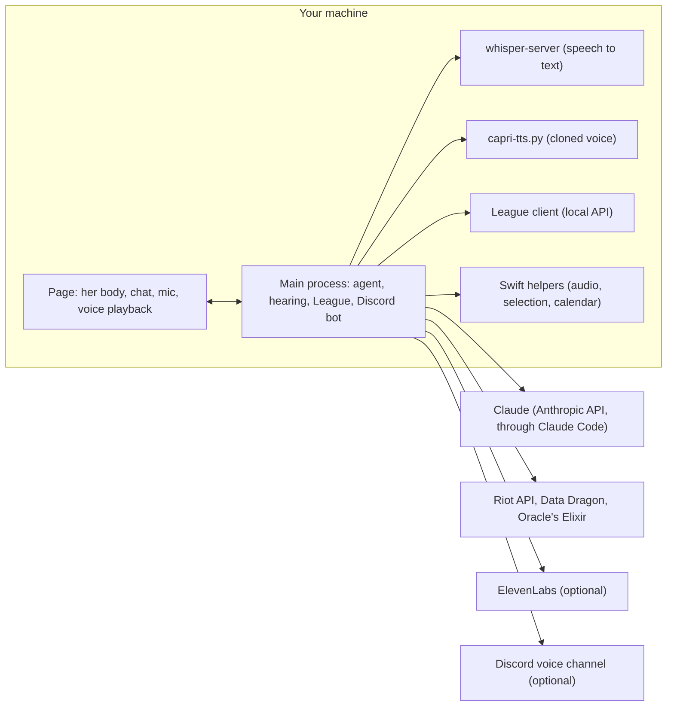

# Capri

<p align="center">
  
</p>

<p align="center"><b>Claude Code, with a body, a mood and an attitude.</b></p>

A desktop companion inspired by Capri, the glitchy construct from *Cyberpunk: Edgerunners* season 2, with Claude Code inside. She lives on top of your screen, glitch-teleports around it and lounges between jobs. Click her and you're talking to a full Claude Code session: she reads, edits and runs things in your project, asks before she touches anything, and tells you when she's done. The attitude stays in the chat; the code, commands and commit messages stay clean.

<p align="center">
  
</p>

<p align="center">
  
</p>

Every image is rendered from the real rig in `src/renderer/`, traced from the show ([Her art](#her-art)).

## What she can do

- **Code with you**: summon her, ask in plain words, allow each edit from a diff card.
- **Pick the right brain**: Claude Haiku 5.5 for quick stuff, Claude Opus 5.5 for real jobs, with a hand-off mid-task.
- **Use your setup**: your MCP servers, skills, slash commands, subagents and `CLAUDE.md`.
- **Work on your selection**: in Neovim or any app, with its file and lines.
- **See your screen**: one look per summon, so "what's this error?" needs no copy-paste.
- **Talk and listen**: push-to-talk, a "Capri" wake word, answers out loud.
- **Remember calls**: an optional local transcript, `/recap` and `/standup`.
- **Keep watch**: your other Claude Code sessions, CI on your repos, messages, meetings, reminders.
- **Know you**: short notes about you, read at the start of every conversation.
- **Draft with you in League**: bans and picks with a chance to win, for you and your squad.
- **Call picks out in Discord**: a bot in your squad's voice channel, in her voice.
- **Speak in a voice you choose**: a local blend you design, a cloned voice (with consent), ElevenLabs or the system voice.
- **Follow you around**: across Spaces and virtual desktops, and out of your screen shares.
- **Look good doing it**: a traced cut-paper puppet with 16 poses, 8 moods and a glitch tear.

## Run it

You need [Claude Code](https://docs.claude.com/en/docs/claude-code) installed and logged in (`claude`, then `/login`). Capri uses that login.

```sh
npm install
npm start
```

Optional:

- **Hear your other Claude Code sessions**: `npm run hooks install` (or the tray); `npm run hooks uninstall` takes them out.
- **Talk to her**: install [whisper.cpp](https://github.com/ggml-org/whisper.cpp) (`brew install whisper.cpp`; on Windows, `whisper-server.exe` on your `PATH`).
- **Keys and settings**: copy `.env.example` to `.env` ([Config](#config)).
- **On macOS**, grant Electron (or the terminal you start her from) Microphone, Accessibility, Screen Recording and Calendars as you turn features on.

## Features

### Coding

- `Cmd+Shift+Space` (`Ctrl+Shift+Space`) summons her next to your cursor with the chat open; `Esc` hands the keyboard back while she keeps working.
- Edits and commands come as cards: **allow**, **always** or **no**, or type what to do instead.
- `/mode` switches between ask before edits, accept edits, plan only and auto.
- `/model auto|<name>` routes by task or pins one model.
- `/resume` picks up her last session in the project; `/undo` puts back her last edits.
- `/cd <folder>` changes her project folder.
- Any other `/command` goes to Claude Code, so your own commands and skills work.

### Neovim

- Select code in visual mode and summon her: the selection comes along with its file and lines. Nothing to install.

### Any app (macOS)

- Your selection in any app, and what you just copied, come along when you summon her.
- Select text, hold right ⌥ and say "make this nicer" or "in English": she rewrites it in place.

### Your screen

- Each summon, she takes one look at your screen and comments; what she saw goes with your first message.

### Voice and ears

- **Push-to-talk**: hold right ⌥ (right Alt), talk, let go.
- **Wake word**: "Capri, …" (`/wake on`).
- **Answers out loud** when you talked to her; `/talk always` for typed messages too.
- **Transcript** (`/listen on`): a local log of what's said near you; ask "what did they decide?" or `/recap`. Recording can need everyone's consent: tell people first.

### Her voice

- `/voice try bella 60 + sky 40 speed 1.1 "Naw, c'mon!"` auditions a local Kokoro blend; `/voice set` keeps it.
- `/voice chatterbox <clip>` clones a voice from a 10–20 s clip, **only with its owner's consent** ([setup](#cloned-voice-setup)).
- `/voice elevenlabs` uses a voice you designed on ElevenLabs.

### Watching your back

- Your Claude Code sessions in other terminals: she tells you when one finishes or needs you.
- `/ci on`: CI on your own repos' pull requests, with what broke.
- `/notify on`: Slack and other messages announced (macOS).
- `/autopilot on`: meetings from your calendar, transcribed and ready for `/recap` (macOS).
- "Note: …" and "remind me in 20 minutes to …", out loud or with `/note` and `/remind`.
- `/standup` drafts your update from git and your meetings.
- `/memory` shows her notes about you; "forget that…" works.
- `/cost` shows today's spend; `/cap 5` sets a daily cap in dollars.

### League of Legends

- `/league on`: in champ select, a card with your best bans and picks, their chance to win and why.
- Ask her "what beats Zed and Lee Sin mid?" or "what should Ashen and I play?".
- `/league key RGAPI-…` adds high-elo solo queue games from your server ([Riot key](#riot-api-key)).
- Tell her about your squad, or edit **League of Legends › Open my squad**: Riot IDs, roles, pools, how they play.
- `/brb`: she accepts the queue, bans and locks in for you while you're away; `/back` stops it.

### Discord

- `/discord on`: her bot joins your voice channel and calls out each squad member's pick, in her voice ([bot setup](#discord-bot-setup)).
- `/discord say <text>`: she says a line there.

### Moods and moves

- Between jobs she lounges, chills, perches, sits on your window or hangs off the top of the screen, and falls asleep if you leave her alone.
- `/dance on`: she dances when music plays.
- `/pose [name]` and `/warp`; drag her around, or untick **Visible** to hide her.
- `/hide on` (the default) leaves her out of screen shares and screenshots.

## Controls and config

### Controls

| Do this | Get this |
|---|---|
| Click Capri | Open / close the chat |
| Drag Capri | Move her (she doesn't love it) |
| Right-click Capri, or the tray icon | Her menu |
| `Cmd+Shift+Space` / `Ctrl+Shift+Space` | Summon her with the chat open |
| Hold right ⌥ / right Alt, talk, let go | Push-to-talk |
| Say "Capri, …" | The same, hands-free (wake word on) |
| `Esc` | Close the chat and hand the keyboard back |
| `Ctrl+C` in her chat | Stop her mid-task |
| `Enter` / `Shift+Enter` | Send / new line |
| `↑` / `↓` in an empty box | Earlier messages |
| Click a code block | Copy it |

### Commands

| Command | |
|---|---|
| `/new`, `/stop`, `/resume` | Fresh conversation, stop the current task, pick up her last session here |
| `/cd <folder>`, `/pwd` | Change or show her project folder |
| `/mode <mode>` | `default`, `acceptEdits`, `plan` or `auto` |
| `/model auto\|<name>` | Switch by task, or pin a model |
| `/undo` | Put back the files her last editing turn changed |
| `/hooks on\|off`, `/quiet` | Claude Code hooks; her commentary on what you do |
| `/wake`, `/listen`, `/ptt` `on\|off` | Wake word, transcript, push-to-talk |
| `/talk on\|always\|off` | Answer out loud when you talk / to typed messages too / never |
| `/voice try …`, `/voice set`, `/voice reset`, `/voice voices` | Audition, keep or reset her voice; list Kokoro's voices |
| `/voice kokoro\|chatterbox <clip>\|elevenlabs\|system` | Pick her voice engine |
| `/recap [topic]`, `/standup` | Recap the last call, draft your standup |
| `/note <text>`, `/remind in 20 min to …`, `/reminders [clear]` | Notes and reminders |
| `/memory`, `/cost`, `/cap <$>\|off` | Her notes about you, today's spend, a daily cap |
| `/ci`, `/notify`, `/autopilot`, `/dance`, `/hide` `on\|off` | CI, messages, meetings, dancing, screen shares |
| `/league on\|off\|update`, `/league key RGAPI-…` | Champ select help, refresh pro data, your Riot key |
| `/brb`, `/back` | Draft for you while you're away, and stop |
| `/discord on\|off`, `/discord say <text>` | Pick call-outs in Discord, say a line there |
| `/commands`, `/pose [name]`, `/warp`, `/help` | Claude Code's commands, a pose, a teleport, this list |

### Config

Put any of these in `.env` (see `.env.example`):

| Variable | Default | |
|---|---|---|
| `CAPRI_FAST_MODEL`, `CAPRI_DEEP_MODEL` | `claude-haiku-5-5`, `claude-opus-5-5` | Quick replies / real jobs |
| `CAPRI_MODEL` | unset | Pin one model |
| `CAPRI_QUIP_MODEL`, `CAPRI_LOOK_MODEL` | the quick model | Her one-liners / her screen looks |
| `CAPRI_PTT_KEY` | `AltRight` | Push-to-talk key ([uiohook](https://github.com/SnosMe/uiohook-napi) name) |
| `CAPRI_WHISPER_MODEL`, `CAPRI_WHISPER_PORT` | `large-v3-turbo-q5_0`, `47915` | Speech-to-text model and port |
| `CAPRI_VOICE_EN`, `CAPRI_VOICE_FR`, `CAPRI_VOICE_RATE` | `Samantha`, `Amélie`, `205` | The system voice |
| `ELEVENLABS_API_KEY`, `ELEVENLABS_VOICE_ID` | unset | Her ElevenLabs voice (`CAPRI_ELEVENLABS_MODEL`: `eleven_flash_v2_5`) |
| `CAPRI_TRANSCRIPT_DAYS` | `14` | Days of transcript kept |
| `CAPRI_CI_OWNERS`, `CAPRI_CI_EVERY` | your `gh` account, `120` | Whose repos CI watching may look at; seconds between checks |
| `CAPRI_NOTIFY_APPS` | `Slack,Messages,WhatsApp,Discord,Signal,Telegram` | Apps whose messages she announces |
| `RIOT_API_KEY` | unset | Riot key for high-elo games (`/league key` wins) |
| `CAPRI_RIOT_PLATFORM` | from the client, else `euw1` | Your League server |
| `CAPRI_SOLOQ_TIER`, `CAPRI_SOLOQ_MIN_TOP`, `CAPRI_SOLOQ_DAYS`, `CAPRI_SOLOQ_MAX` | `diamond`, `5`, `21`, `60000` | Lowest tier, players at it per game, days kept, games kept |
| `CAPRI_LEAGUE_DIR` | the default install | League's install folder (the one with `lockfile`) |
| `DISCORD_BOT_TOKEN`, `DISCORD_USER_ID` | unset | Your Discord bot's token and your own user id |
| `CAPRI_CWD`, `CAPRI_PORT` | your home folder, `47913` | Her starting project folder; the hooks' port |
| `CAPRI_START_HIDDEN`, `CAPRI_DEBUG` | unset | Start hidden; DevTools and Claude Code's stderr |
| `CAPRI_USE_API_KEY` | unset | `1` uses `ANTHROPIC_API_KEY` instead of your login (otherwise it's ignored, so a stale one can't break sign-in) |

### Discord bot setup

1. In the [Discord developer portal](https://discord.com/developers/applications): **New Application**, then **Bot › Reset Token** and copy the token.
2. **OAuth2 › URL Generator**: scope **bot**, permissions **View Channels**, **Connect**, **Speak**, **Use Voice Activity**; open the link and add her to your server.
3. Your user id: Discord **Settings › Advanced › Developer Mode**, then right-click your name › **Copy User ID**.
4. `DISCORD_BOT_TOKEN` and `DISCORD_USER_ID` in `.env`, restart, `/discord on`.

### Cloned voice setup

```sh
python3 -m venv ~/Library/Application\ Support/capri/chatterbox/venv
~/Library/Application\ Support/capri/chatterbox/venv/bin/pip install chatterbox-tts "setuptools<80"
```

Then `/voice chatterbox ~/path/to/clip.mp3`: a clip of one person talking, no music, from someone who agreed. The first start downloads the model (about 3 GB).

### Riot API key

Get one at [developer.riotgames.com](https://developer.riotgames.com) and give it to her with `/league key RGAPI-…`. Development keys expire after 24 hours; a personal key (register a project) doesn't.

## How she works

### Built with

| Part | Technology | What it does for her |
|---|---|---|
| App | [Electron](https://www.electronjs.org/) 45 | One transparent, click-through overlay window, the tray, the global shortcut |
| Brain | [Claude Agent SDK](https://docs.claude.com/en/docs/agent-sdk/overview) (Claude Code as a library) | The full Claude Code agent: tools, permissions, `CLAUDE.md`, MCP, skills, subagents |
| Models | Claude Haiku 5.5, Claude Opus 5.5 | Quick replies, one-liners and screen looks; real jobs |
| Her own tools | An in-process MCP server, [zod](https://zod.dev) schemas | `escalate`, `remember` / `forget`, the `league_*` tools |
| Body | SVG, Canvas 2D, a `requestAnimationFrame` loop, CSS keyframes | The cut-paper puppet on twos, the glitch tear, shards and streaks |
| Ears | [whisper.cpp](https://github.com/ggml-org/whisper.cpp) server with the Silero VAD, Web Audio worklets | Local speech-to-text (French and English), wake word, push-to-talk, transcript |
| Voice | [Kokoro-82M](https://huggingface.co/hexgrad/Kokoro-82M) via [kokoro-js](https://www.npmjs.com/package/kokoro-js); [Chatterbox](https://github.com/resemble-ai/chatterbox) (PyTorch, Apple GPU or CUDA); ElevenLabs; the OS voice | A blend you design, a clone, a hosted voice or the system one, through a bitcrusher |
| macOS | Swift helpers: ScreenCaptureKit, Accessibility, AppKit, EventKit | The computer's audio, your selection and clipboard, message banners, your calendar |
| Desktop glue | [uiohook-napi](https://github.com/SnosMe/uiohook-napi), [koffi](https://koffi.dev) | The push-to-talk key from any app; window frames, Spaces and virtual desktops |
| Neovim | msgpack-RPC over each nvim's socket | Your visual selection |
| League | The League client's local API; [Oracle's Elixir](https://oracleselixir.com); Riot's API (league-v4, match-v5, account-v1) and Data Dragon | Champ select; pro and high-elo games; your squad's own games |
| Draft math | Plain JavaScript in a `worker_threads` thread | Chances to win, matchups by role, player levels, the team check |
| Discord | [discord.js](https://discord.js.org), [@discordjs/voice](https://www.npmjs.com/package/@discordjs/voice), Opus ([opusscript](https://www.npmjs.com/package/opusscript)), DAVE ([@snazzah/davey](https://www.npmjs.com/package/@snazzah/davey)) | Her bot in your voice channel |
| Hooks and CI | A small hook script posting to `127.0.0.1`; the `gh` CLI | Your other Claude Code sessions; your own repos' CI |

### What runs where



Speech-to-text, the local voices, the League client and the draft math stay on your machine; what goes out is in [What she sees and sends](#what-she-sees-and-sends).

### The brain


- One conversation, two brains: the router in `agent.js` is plain pattern matching (keywords, slash commands, message length, a recent Opus job), so choosing costs no model call.
- Haiku can hand a task up mid-turn with its `escalate` tool; the switch uses the SDK's `setModel` on the live session, with everything so far in context.
- She runs Claude Code itself with every settings source loaded, so your MCP servers, skills, commands, subagents, `CLAUDE.md` and permissions all apply. Her own `AskUserQuestion` is off: questions and permission prompts go through the chat.
- In front of each message, the app adds a short note: League's state, whether she's in your Discord call, what she said out loud lately, and your squad's names.

### Draft math

- **Draft %**: a champion's win rate in your role, plus its record against your lane opponent (both of them in bot lane), against each other enemy and with your teammates' picks, all in log-odds so they add up. Enemy roles are guessed from where each champion is played.
- **Your edge**: your own record on that champion and role from your recent games, next to your overall win rate.
- **Honest numbers**: every record is pulled toward the average by a few hundred games' worth, so a 2-0 says almost nothing; most picks land between 47% and 56%.
- **Player levels**: each squad player's damage next to the high-elo average on the same champion and role (or set by hand). For a player below average, champions are judged by their low-damage games.
- **Team check**: projected damage, AD/AP, CC, frontline and who carries, from per-player stats in the high-elo games.
- **Carry threats**: point-and-click CC and easy lockdown (`carry-threats.json`, plus heavy-CC champions that win from behind in the data) push bans.
- **Data**: Oracle's Elixir's pro games, refreshed every few days; with a Riot key, Diamond+ solo queue on your server (games where at least 5 of 10 players are at that level), crawled in the background at about 2,500 games an hour and kept for 21 days. A pro game counts half once there's solo queue data.

### The voice pipeline

- Four engines, each falling back to the next: Chatterbox (cloned), Kokoro (blend), ElevenLabs, the system voice. Kokoro and Chatterbox speak English only.
- Every line goes through her glitch: a bitcrusher with bursts, then a band-pass, in the page and again for Discord (48 kHz stereo, Opus).
- Chatterbox runs as `tools/capri-tts.py` on 127.0.0.1; text goes in short pieces so fragments don't turn into babble, and everything it makes is watermarked.

### Her body

| Pose | When |
|---|---|
| **think** | Waiting on Claude's first words |
| **hack**: typing into the air | Claude Code is running tools |
| **point** | A permission card is waiting |
| **victory** | A long task just finished |
| **crouch** / **knock** | Another session or a CI run needs you |
| **lounge**, **chill**, **crossed**, **hug**, **perch**, **float** | Between jobs, mostly lounging and chilling |
| **ledge** / **hang** | Sitting on your window's top edge / upside down off the top of the screen |
| **dance** | Music's playing, with dancing on |
| **sleep** | Nothing from you for 4 minutes |

- Each reply starts with a hidden mood tag (`[[smug]]`, `[[hype]]`, `[[glitch]]`…) that sets her face and how she moves.
- She's a cut-paper SVG puppet animated on twos (12 fps): the art is drawn once and rendered through several copies for the pink and cyan glitch tear; limbs are chains of jagged segments posed by joint angles.
- The overlay is one transparent, always-on-top window that lets clicks through except over her and her chat. It follows you across Spaces and virtual desktops, and is left out of screen captures.

### What she sees and sends

- **Hooks**: your Claude Code sessions report a few events to `127.0.0.1:47913`; the script never blocks Claude Code.
- **Reactions**: finished tasks and permission prompts are always announced; a few other events get a Haiku one-liner, which sends that event to the model (`/quiet` turns them off).
- **Your screen**: one screenshot per summon to Haiku; only its text description goes into your conversation.
- **Selection and clipboard**: read only when you summon her; password-manager copies are skipped.
- **Mic and computer audio**: only while the transcript, wake word or push-to-talk need them; speech-to-text is local.
- **The window you're in**: its position and size only, to sit on it.
- **GitHub**: with CI watching on, only your own open PRs in your own repos.
- **League**: the client's local API; with a Riot key, the ladder and ranked games from Riot (no player names or ids stored); only what she uses for an answer goes to Claude.
- **Each message's note**: League's state, Discord, her recent spoken lines and your squad's names go to Claude with the message.
- **Voice and Discord**: with ElevenLabs, the text of each line she says; the Discord bot joins deafened and only sends her voice.
- **Notifications and calendar**: read locally, never sent to a model.
- **Local files** in her data folder: her notes, the spend meter, voice notes, reminders, transcripts, the League data and your squad.

### Files

```
src/
  main.js        Electron main: overlay window, tray, hotkey, IPC, wiring
  agent.js       Her Claude Code session: routing, the hand-off, permissions, modes
  persona.js     Her voice and mood tags, on top of Claude Code's system prompt
  companion.js   Hook listener, file watcher, her one-liners
  hooks.js       Installs / removes the hooks in ~/.claude/settings.json
  nvim.js        The Neovim selection
  look.js        The screen look on summon
  mac.js         The macOS helper: selection, rewrite in place, clipboard, banners, calendar
  rewrite.js     Rewriting a selection in one Haiku call
  hearing.js     Ears and voice wiring: transcript, wake word, push-to-talk, talking back
  ears.js        Mic and computer audio into utterances
  whisper.js     whisper-server
  transcript.js  The daily transcript files
  ptt.js         The push-to-talk key
  voice.js       Her voice engines: Chatterbox, Kokoro, ElevenLabs, the system voice
  discord.js     Her bot in your Discord voice channel
  league.js      Champ select: watcher, draft card, brb, call-outs, her league_* tools
  lcu.js         The League client's local API
  prodata.js     Pro and solo queue games: storage and stats
  soloq.js       The high-elo solo queue crawl and your squad's games
  draft.js       Chances to win, bans, player levels, the team check
  squad.js       The people you play with
  ci.js, routines.js, memory.js, costs.js, notes.js, meetings.js
  frontmost.js, workspaces.js, config.js, preload.js
  renderer/      Her body (art, rig, poses, mouth, portrait, fx), the chat, sound and app logic
tools/
  capri-hook.js       The hook command Claude Code runs
  capri-ears.swift    The Mac's system audio (ScreenCaptureKit)
  capri-mac.swift     Her hands on macOS
  capri-tts.py        The Chatterbox server for a cloned voice
  trace_art.py, trace_portrait.py   Trace her art from reference frames
docs/                 The GIF and the pose / mood sheets, rendered from the rig
```

### Her art

Her body and face are traced, not hand-drawn: `tools/trace_art.py` reads a frame of her from the show (`reference/capri-full.png`, kept out of git), splits it into flat color layers, traces each into polygons, lifts the hair glitter out as a mask, cuts her into puppet pieces with pivots, and maps the face on through the eye centers. `tools/trace_portrait.py` does the face close-up. To re-trace, put the frames in `reference/` and run them (Python 3.11+ with `numpy`, `opencv-python` and `pillow`).

## Ideas for next steps

- Steer your other Claude Code sessions from her: answer their permission prompts, send follow-ups, a board of what's running
- Background jobs in git worktrees, each shown as a small glitch clone of her
- Real-time voice: interrupt her by talking, speak as the reply streams
- Two-way Neovim: her findings as diagnostics, edits straight into the buffer
- A packaged, signed Capri.app, and a settings panel instead of the long tray menu
- Multi-monitor roaming

## Credits

Capri (Project Capricorn) comes from *Cyberpunk: Edgerunners*, by Studio Trigger and CD PROJEKT RED. This is an unofficial fan project, made for fun and not affiliated with either. The brain is [Claude Code](https://docs.claude.com/en/docs/claude-code) through the Claude Agent SDK.
