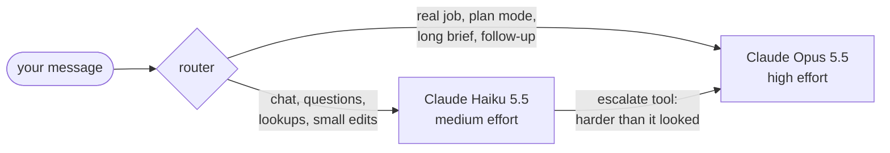
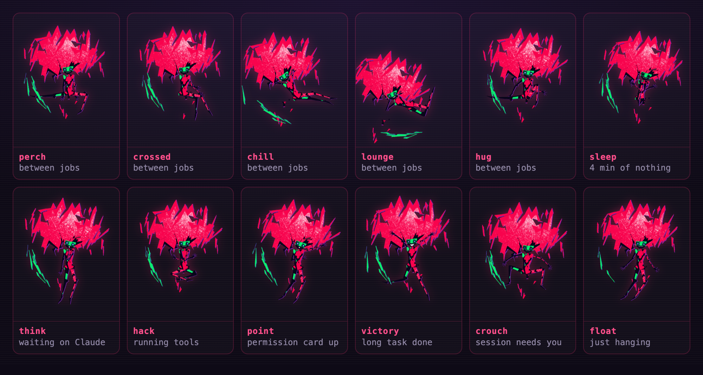
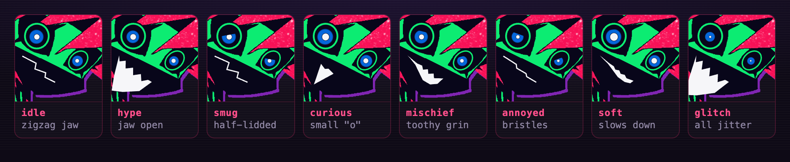

# Capri

<p align="center">
  
</p>

<p align="center"><b>Claude Code, with a body, a mood and an attitude.</b></p>

A desktop companion inspired by Capri, the glitchy construct from *Cyberpunk: Edgerunners* season 2, with Claude Code inside. She's a little cut-paper girl of black shards under a huge glittering hot-pink mane, with a green mask, ringed blue eyes and a black jaw full of jagged white teeth. She lives on top of your screen, **glitch-teleports** around it, and lounges between jobs: perched, legs crossed, lying on her belly in mid-air, hugging a knee, or curled up asleep if you leave her alone.

Click her and you're talking to Claude Code: she reads, edits and runs things in your project, asks before she touches anything, and tells you when she's done. Quick stuff gets a fast answer from Claude Haiku 5.5; real jobs go to Claude Opus 5.5. She also listens to the Claude Code sessions in your terminals, so she can tell you when one of them finishes or needs you, and now and then she has an opinion about what you're doing ("wtf is `utils2_final_REAL.ts`, choom?").

Capri is a side project, built for fun, but she isn't a toy: she's a full Claude Code session with a router in front of it, so the attitude stays in the chat while the code, the commands and the commit messages stay clean.

## What she can do

- **Change code, fast.** `Cmd+Shift+Space` (`Ctrl+Shift+Space` on Windows and Linux) and she warps next to your cursor with the chat open. Ask in plain words: she reads the code, makes the edit, runs the tests, and shows every edit as a diff card you allow in one click (or switch to *accept edits* and let her go). `Esc` puts her away and hands the keyboard back to your editor while she keeps working, so it's summon, ask, `Esc`, back to your code. `/resume` picks up where you left off.
- **Route each job to the right brain.** Haiku answers chat, lookups and small edits fast, Opus takes refactors, debugging and reviews, and Haiku can hand a task up mid-turn when it turns out harder than it looked. Same conversation, nothing lost. → [Agent routing](#agent-routing)
- **Use your MCP servers, skills and commands.** She runs on Claude Code itself, so the MCP servers, `CLAUDE.md`, skills, slash commands and subagents you've set up are hers too. → [MCP and the rest of your setup](#mcp-skills-and-the-rest-of-your-setup)
- **Work on what you've selected.** Select code in Neovim, summon her, and ask "what does this do?" or "make this async": the selection comes along with its file and line numbers. → [From Neovim](#from-neovim)
- **Talk to her, out loud.** Hold right ⌥ and talk, or say "Capri, …": she answers in a bitcrushed voice. With the always-on log, she can also tell you what was said on that call an hour ago. → [Talking out loud](#talking-out-loud)
- **See what you're looking at.** Each summon, she takes one look at your screen: a quick remark in the chat, and what she saw goes along with your first message, so "what's this error?" needs no copy-paste. → [A look at your screen](#a-look-at-your-screen)
- **Follow you around.** Switch to another Space or virtual desktop and she glitches out of the old one and tears back in on yours.
- **Keep an eye on your other sessions.** Through Claude Code hooks she tells you when a session in another terminal finishes or is waiting on you, and goes and knocks on your window about it. She can also watch CI on your own repos' pull requests. → [Routines](#routines)
- **Know you.** She keeps short notes about you (name, habits, projects, running jokes) and reads them at the start of every conversation. `/recap` turns the last call into decisions and action items, `/standup` drafts your update. → [Routines](#routines)
- **Work with whatever you're in.** On summon she brings what you've selected in any app, and what you just copied. Select a Slack draft, hold right ⌥ and say "make this nicer" or "in English": she rewrites it in place. → [Any app](#any-app)
- **Keep track for you.** "Note: …" and "remind me in 20 minutes to …" by voice, Slack and other messages announced as they come, meetings from your calendar transcribed and ready for `/recap`, `/undo` for her last edits.
- **Draft with you in League.** In champ select she shows your best picks with champion icons and a chance to win, worked out from recent pro games and high-elo solo queue on your server, every enemy matchup and your own record on each champion. She knows your squad's pools, and if you need to brb she accepts the queue, bans and locks in for you. → [League of Legends](#league-of-legends)
- **Look good doing it.** A traced cut-paper puppet animated on twos, with 16 poses, 8 moods, a live face and a pink-and-cyan glitch tear. → [What she looks like](#what-she-looks-like)

## Run it

You need [Claude Code](https://docs.claude.com/en/docs/claude-code) installed and logged in (run `claude` once and `/login`). Capri uses that login; there's no API key to set up.

```sh
npm install
npm start
```

Then, if you want her to hear from your other Claude Code sessions:

```sh
npm run hooks install     # or tick "Hooked into Claude Code" in her tray menu
```

This adds a few async hooks to `~/.claude/settings.json` (a backup goes to `settings.json.capri-backup`). `npm run hooks uninstall` takes them out again and `npm run hooks status` shows what's there.

To talk to her out loud, install [whisper.cpp](https://github.com/ggml-org/whisper.cpp) for speech-to-text (`brew install whisper.cpp` on macOS; on Windows, put `whisper-server.exe` on your `PATH`). She downloads the model (~575 MB) the first time she listens. See [Talking out loud](#talking-out-loud).

## Talking to her

Open the chat (click her, or `Cmd+Shift+Space` / `Ctrl+Shift+Space`) and ask for anything you'd ask Claude Code. She works in her **project** folder: pick it from the tray menu or with `/cd`.

- **Tool calls** show up as a compact list under her reply, ✓ or ✗ when each one finishes.
- **Permissions**: before an edit or a command she shows a card with the diff or the command. Pick **allow**, **always** (for the rest of the session) or **no**, or just type, which says no and tells her what to do instead. If the chat is closed she pops up a cut-in so you notice.
- **Permission modes**, from the tray or `/mode`: *ask before edits* (default), *accept edits*, *plan only*, *auto*. In plan mode she proposes a plan and asks to go ahead.
- `Esc` closes the chat and gives the keyboard back to the app you summoned her from (nvim, your terminal…). She keeps working, and a cut-in pops up if she needs you.
- `Ctrl+C` in her chat (or `/stop`) stops her mid-task, like in the CLI.

| Command | |
|---|---|
| `/new` | Fresh conversation |
| `/stop` | Stop the current task (same as `Ctrl+C` in her chat) |
| `/resume` | Pick up her last session in this project |
| `/cd <folder>`, `/pwd` | Change or show her project folder |
| `/mode <mode>` | `default`, `acceptEdits`, `plan` or `auto` |
| `/model auto\|<name>` | Switch by task, or pin a model (`claude-opus-5-5`, `sonnet`…) |
| `/hooks on\|off` | Install or remove the Claude Code hooks |
| `/quiet` | Toggle her commentary on what you do |
| `/wake`, `/listen`, `/talk`, `/ptt` `on\|off` | The "Capri" wake word, the always-on transcript, talking out loud, push-to-talk (same as the tray); `/talk always` answers typed messages out loud too |
| `/recap [topic]`, `/standup` | Recap the last call, draft your standup (local files only) |
| `/memory`, `/cost`, `/cap <$>\|off` | Her notes about you, today's spend, a daily spending cap |
| `/ci on\|off`, `/dance on\|off`, `/hide on\|off` | Watch CI on your own repos, dance when music plays, stay out of screen shares |
| `/note <text>`, `/remind in 20 min to …`, `/reminders [clear]` | A note to self, a reminder, your pending reminders |
| `/undo` | Put back the files her last editing turn changed |
| `/notify on\|off`, `/autopilot on\|off` | Messages (Slack…) announced, meeting autopilot (macOS) |
| `/league on\|off\|update`, `/league key RGAPI-…` | League champ select help, refresh the pro data now, your Riot API key for high-elo solo queue games |
| `/brb`, `/back` | Draft for you while you're away, and stop |
| `/voice try <blend> [speed x] ["text"]`, `/voice set`, `/voice voices`, `/voice kokoro\|elevenlabs\|system` | Design her voice: hear a blend of Kokoro voices, keep it, list them, pick the engine |
| `/commands` | List Claude Code's slash commands in this project |
| `/pose [name]` | Strike a pose for a minute (no name lists them) |
| `/warp`, `/help` | Teleport somewhere / show this list |

Any other `/command` goes to Claude Code, so your custom commands and skills work too.

### From Neovim

Select some code (`v`, `V` or `Ctrl-V`) and summon her without leaving visual mode. The selection shows up as a chip above the input (`⧉ app.ts:12-30`) and goes in front of your next message with its file path and line numbers, the way Claude Code's IDE integration passes one along. Ask "what does this do?", "rename these", "make this async"; ✕ on the chip drops it. Summon her again with a new selection and she swaps it in.

There's nothing to install on the Neovim side: every nvim listens on an RPC socket by default, so she asks each one whether it's in visual mode and, if one is, for the selected text. Her edits land in the file, and nvim reloads it when you switch back (that's `autoread`, on by default). A selection over 20,000 characters goes by file and line numbers only, and she reads it herself.

### Any app

On macOS, a summon also brings what you're working with elsewhere, through Accessibility:

- **Your selection in any app** (Safari, Mail, Slack, VS Code, Notion…) comes along as a `⧉` chip, like a Neovim selection. Native apps hand it over directly; for Electron apps and Chrome she presses ⌘C for you once you've let go of the shortcut, reads it, and puts your clipboard back exactly as it was.
- **What you just copied** (in the last 2 minutes) comes as a `⎘ copied` chip. Anything a password manager copies is marked as concealed, and she never reads those.
- **Rewriting in place**: select some text, hold right ⌥ (or say "Capri, …") and ask for a change: "make this nicer", "fix the grammar", "in English", "corrige les fautes", "rends ça plus poli". One Haiku call rewrites it and the result replaces your selection where it is; ⌘Z in that app takes it back. Anything else you say about a selection ("what does this mean?") goes to her as a question, with the selection attached.

Both chips can be turned off in the tray (**Bring my selection from any app**, **Offer what I just copied**). They only read anything at the moment you summon her.

### A look at your screen

When the summon shortcut opens her chat, she takes one screenshot of the display you're on, from just before she lands. Claude Haiku 5.5 looks at it (low effort, no tools) and sends back two things: a line in her voice, which shows up in the chat, and a plain description of what's in front of you (the app, the file or page, any error or stack trace, quoted). The description becomes a `◉ screen` chip and goes in front of your next message, so Opus or Haiku can work from it without ever getting the image. ✕ on the chip drops it.

Only a summon (the shortcut, the tray icon, push-to-talk or the wake word) triggers a look, at most one per summon and only when it opens the chat: clicking her, closing the chat with the shortcut and everything she does on her own don't. A look costs one small Haiku call with a ~1,500-pixel JPEG and takes a few seconds; if you send your message before it's back, she waits up to 6 seconds for it. Turn it off with **Look at my screen when summoned** in the tray.

On macOS she needs Screen Recording permission (System Settings › Privacy & Security). If you start her with `npm start`, macOS may list your terminal app rather than Electron. Until it's granted she tells you once and skips the look. She doesn't look on Linux, where Wayland would ask you to pick a screen every time.

### Talking out loud

Speech-to-text runs on your machine with whisper.cpp (large-v3-turbo by default, French and English, switching mid-sentence is fine), so listening costs no tokens. Everything is in the tray menu:

- **Push-to-talk** (on by default): hold **right ⌥** (right Alt on Windows) from any app, talk, let go. She warps over and your words go out as a message, with your Neovim selection and her look at the screen like a summon. Hold it on its own: pressing another key or clicking while it's down cancels, so typing ⌥-characters still works.
- **Wake word "Capri"**: say "Capri, what does this error mean?" and she comes over with that question. A bare "Capri" gets a "yeah?", and whatever you say next goes to her. It only counts at the start of what you say, so talking *about* Capri doesn't wake her, and never from the computer's audio.
- **Talk out loud** (on by default): when you talked to her, she answers out loud, in the voice you set with `/voice` ([Her voice](#her-voice); the macOS voice until you do), through a bitcrusher, and her jaw moves with it. She keeps it to a few spoken sentences and leaves code in the chat. Typed chats stay silent unless you turn on `/talk always` (or **…to what I type too** in the tray): then typed replies are read out too, without the code, links and lists, and cut to their first few sentences. She also says her short asides ("done!", "needs you") out loud, at most one every 20 seconds and never while there's talking on the computer's audio, so she won't chime in on a call.
- **Always listening (transcript)**: everything said near you goes into a local log: your mic as `[me]`, the computer's audio (the other side of calls) as `[call]`, one Markdown file per day, kept 14 days. **Open transcripts** shows the folder. The menu bar shows **● REC** while it's on. She only reads it when you ask about something that was said ("what did they just decide?", "what did Marc say about the deadline this morning?") or when your request clearly depends on it, and then only the part she needs, so it doesn't burn tokens in the background.

Recording a conversation can need everyone's consent where you are (it does in France): tell people, or keep the log off on calls.

On macOS she needs a few permissions, for Electron or the terminal you start her from: **Microphone**, **Accessibility** (the push-to-talk key, your selection in other apps, rewriting in place, message banners), **Calendars** (the meeting autopilot) and **Screen Recording** (for the computer's audio; it's the same one as the screen look). The computer's audio comes through a small ScreenCaptureKit helper, `tools/capri-ears.swift`, which she builds the first time with the Xcode command line tools. On Windows it's Chromium's loopback capture, and her voice is the Windows one; neither has been tested there yet.

### Routines

- **`/recap [topic]`**: the last call from the transcript, as one line on what it was about, then decisions, action items (who → what, with dates) and open questions, with times.
- **`/standup`**: a draft of your update since the last working day, from `git log` in the folders you had Claude Code sessions in, plus the transcript for meetings. The first time you open her on a weekday morning, she offers it in one line; nothing runs until you ask.
- Both read local files only: no `git fetch`, no `gh`, no network, and they never create tickets, issues or messages anywhere.
- **Her notes about you**: she saves short facts with her own `remember` / `forget` tools (no permission card) when she learns something that'll still matter next week, and reads them at the start of every conversation. `/memory` shows them, **Open her notes about me** in the tray opens the file to edit, and "forget that…" works in chat.
- **CI on your own repos** (off by default; `/ci on` or the tray): every 2 minutes she checks the open PRs you authored, with your `gh` login. Only repos owned by your GitHub account are queried, or by the owners you list in `CAPRI_CI_OWNERS`; the owner filter is part of the search, so work orgs never see a request from her. When a PR goes red she reads the failed job's log and one Haiku call says what broke, and she knocks on your window about it. When it goes green again, she says so, for free.
- **Dancing** (off by default; `/dance on` or the tray): when music plays on the computer, she dances and bounces on the beats. It only measures loudness, with nothing transcribed, but it uses the same computer-audio capture as the transcript, so macOS shows its screen-recording indicator while it's on.
- **The cost meter**: today's spend shows in the chat header (hover for each model) and with `/cost`: her chat, one-liners, screen looks and CI diagnoses, from the SDK's own estimates (not a bill). `/cap 5` sets a daily cap in dollars: once it's reached she stops sending new messages, one-liners and looks until tomorrow, or until you raise it (`/cap off` drops it).
- **Notes and reminders**, said out loud (push-to-talk or "Capri, …") or typed: "note: call the bank", "note que la démo est jeudi", "remind me in 20 minutes to check the deploy", "rappelle-moi à 15h d'appeler Marc". They're handled on the spot, with no model call: notes go to a dated file (**Open my voice notes** in the tray, or `/note <text>`), reminders survive restarts and she comes and knocks on your window when one is due. `/remind in 20 min to …`, `/reminders` lists them, `/reminders clear` drops them.
- **Messages** (off by default; `/notify on` or the tray): when Slack, Messages, WhatsApp, Discord, Signal or Telegram shows a notification, she pops up with it and says who it's from ("Slack message from Julie"). She reads the banner through Accessibility; the text stays on your screen and never goes to a model. `CAPRI_NOTIFY_APPS` changes the list. She keeps quiet during calls.
- **Meeting autopilot** (off by default; `/autopilot on` or the tray): she reads your calendar on this Mac (Calendars permission, nothing fetched from a server). A minute before a meeting with a video link or other attendees she pops up; while it runs the transcript is on (she turns it back off after if it was off), with the meeting's start and end marked in it; at the end she offers `/recap`. Titles stay local unless you ask for the recap.
- **`/undo`** puts back the files her last editing turn changed (each turn is checkpointed before she edits), and the next `/undo` goes one turn further. It covers her file edits, not what she changed through shell commands, and only in the current conversation.
- **Your day**: she yawns and falls asleep sooner after midnight, comments on your weekend coding and Friday evenings, gets sleepy on low battery and perks up when you plug in, tells you to stretch after two hours without a break, and gives a Friday-afternoon, weekend or late-night deploy a look. All canned, no model.

### League of Legends

Out of game only: champ select, never anything once the game loads. Turn it on with `/league on` or **League of Legends › Help me draft in champ select** in the tray.

- **Your turn**: when your ban or pick comes up, she strikes a thinking pose, then comes over with a card: champion icons, each with a chance to win and why (`you 63% in 41 · 57% vs Lulu (23) · pro 52% support`), and says the top one out loud. In her chat, "what should I pick?" or "what beats Zed and Lee Sin mid?" gets the same card and her take on it.
- **Counters first.** For "what should I pick into Jax, Sejuani, Katarina, Seraphine, Ashe?" she ranks every champion in your role by its **draft %**: its win rate in the role, plus its record against your lane opponent (both of them in bot lane), less so against each other enemy, and with your teammates' picks. Only then does she look at your pool and say what it costs ("Shaco 50%, 1 point below the strongest"), and with several roles she compares them, so "which role should I play" gets an answer too. Each squad friend you ask about gets the same, in their roles.
- **The chance to win** on your card adds **your own edge** to the draft %: your record on that champion from your last 100 Summoner's Rift games in the client, compared with your overall win rate, so winning a lot in general doesn't inflate every pick. Champions you don't play count as your average, not as a penalty.
- **Honest numbers.** Real differences between champions are small (a champion's win rate in its role spreads about 3 points, a lane matchup about 4), so every record is pulled toward the average by a few hundred games' worth: a 2-0 says almost nothing, a 300-game record says something. Matchups with fewer than 8 games (lane) or 15 (other pairings) never show up as reasons. Expect most numbers between 47% and 56%, and close to 50% everywhere while there's little data. The ranking is what matters; a card saying 75% would be lying. Enemy roles are hidden in ranked, so they're guessed from where each champion is played.
- **Your squad**: tell her who you play with ("Oswiz jungles, Amumu and Xin, random invades get him gapped…") and she saves it with her `league_squad` tool, or edit **League of Legends › Open my squad** (`squad.json`): in-game names and nicknames (`aka`), Riot IDs, roles, champion pools per role (a class like `tanks` or `marksmen` works too), notes on how they play. Your own pool shapes your picks and is all brb ever locks for you. Friends in your party are recognised in champ select, even when ranked hides names, and their pools get scored against the enemy comp. She never suggests banning what you or they play.
- **Players aren't equal.** With a Riot ID (or several, for alt accounts), she reads that player's last 60 ranked and draft games per account in the background: their own record per champion and role (the same role counts fully, the champion's other roles half; the "you" part, for them too), and their **damage level**, their share of their team's damage next to the high-elo average on the same champion and role (1 is average, 0.66 two thirds). You can also set a level by hand. For a player below average she ranks champions by how they hold up when their player deals little: each champion's win rate in its own low-damage games, next to the role's. A tank or an engage support barely drops; a mage whose only job is damage drops a lot, so "Cobika on Xerath" scores lower than "Cobika on Galio". For a player above average she looks at the high-damage games instead.
- **Team check** (`league_team`, and at the end of every multi-player answer): projected damage (each champion's usual share of its team's damage times its player's level, against a usual team), AD/AP split, CC, frontline and who carries, with warnings like "low damage", "almost all AD" or "no real frontline". These come from the per-player stats in the high-elo games (damage dealt and taken, magic share, enemies immobilized).
- **Carry threats**: `carry-threats.json` in her League folder lists champions that shut down a skilled player: point-and-click hard CC (Malzahar, Lissandra, Vi, Pantheon, Nautilus…) and easy champions whose lockdown works even when their player is behind (Lux, Veigar). The high-elo profiles add that second kind on their own: champions with much more CC than their role's usual that keep winning in their low-damage games. She flags carry threats on the enemy team and leans her bans toward them. Edit the list freely.
- **brb** (`/brb`, the tray, or just tell her "brb, pick for me"): she accepts the queue, bans, and when your pick comes up hovers what you'd hovered, or else her best pick from your pool, then locks it in with 6 seconds left. Change the hover yourself and she backs off. She turns brb off when the game loads and comes to tell you what you're on; `/back` turns it off early.
- **The pro data** is [Oracle's Elixir](https://oracleselixir.com)'s match data: every game of the major and minor leagues this year, downloaded from its public Google Drive folder the first time and refreshed every 3 days (last year's too, early in the year). It's boiled down to a small JSON in her `league` data folder. Drive sometimes refuses the download for a day when the file has been popular ("over quota"); she keeps the copy she has, and you can download the CSV from oracleselixir.com yourself and drop it in that folder (**Open the pro data folder** in the tray). Pro play isn't solo queue, so she says so when it matters; your own record and your squad notes are what bring it back to how you actually play.
- **High-elo solo queue** (with your Riot API key): she collects ranked solo games from the top of your server's ladder, Diamond and up by default (`CAPRI_SOLOQ_TIER`: `emerald`, `diamond`, `master`, `grandmaster` or `challenger`), and keeps a game only when at least 5 of the 10 players are at that level right now. There are far more Diamond+ games than a development key can fetch (about 100 requests every 2 minutes, roughly 2,500 games an hour), so the crawl runs in the background whenever she has a key: the ladder once a day (all of Diamond is about 200 pages), then random players' new games, appended to a file as they come. She keeps the newest 60,000 games of the last 21 days (`CAPRI_SOLOQ_MAX`, `CAPRI_SOLOQ_DAYS`), so after a day of running a common lane matchup has hundreds of games. Stats are rebuilt in the background every 20 minutes, without freezing her. Once there's solo queue data, a pro game counts half as much. Get a key at [developer.riotgames.com](https://developer.riotgames.com) and give it to her with `/league key RGAPI-…` (it's checked, then kept encrypted in the keychain, and never sent to a model) or as `RIOT_API_KEY` in `.env`. A development key expires after 24 hours; when it does she tells you, and `/league key` with a new one picks up where she stopped. A personal API key (register a project on the same site) doesn't expire. Your server comes from the League client, or `CAPRI_RIOT_PLATFORM` (`euw1` by default). The games are stored without player names or ids.
- **How she reads the client**: through the League client's local API on 127.0.0.1, the same one Blitz, Porofessor and U.GG use (the port and password come from its lockfile). She reads your champ select, mastery, match history and party, and hovers, bans, locks and accepts through it. Locking a pick or ban from her chat goes through a permission card, because it's final.

### Her voice

Four engines, each falling back to the next, all through her bitcrusher glitch:

- **Kokoro**, local and free: [Kokoro-82M](https://huggingface.co/hexgrad/Kokoro-82M) (Apache-2.0) running inside Capri, about twice as fast as real time on a Mac's CPU. You design her voice by blending its English preset voices by ear: `/voice try bella 60 + sky 40 speed 1.1 "Naw, c'mon!"` says the line right away (`/voice voices` lists the presets), `/voice set` keeps it, `/voice reset` goes back. The model (~90 MB) downloads into her data folder the first time. English only, so a French line goes to the next engine.
- **Chatterbox**, a cloned voice, local: [Chatterbox](https://github.com/resemble-ai/chatterbox) (Resemble AI, MIT) copies a voice from a 10 to 20 second clip of one person talking, no music. **Only clone a voice whose owner said yes.** Everything it makes carries Resemble's inaudible watermark, so it can be told apart from a real recording. Install it once in its own environment:
  ```sh
  python3 -m venv ~/Library/Application\ Support/capri/chatterbox/venv
  ~/Library/Application\ Support/capri/chatterbox/venv/bin/pip install chatterbox-tts "setuptools<80"
  ```
  (the watermarker still needs `pkg_resources`, which newer setuptools dropped). Then `/voice chatterbox ~/path/to/clip.mp3`: she keeps a copy of the clip, starts `tools/capri-tts.py` (the first time downloads the model, about 3 GB) and talks in that voice. `/voice try energy 0.8 "Naw, c'mon!"` tunes how theatrical she is (0.25 to 2), `pace` how fast (0 to 1). It's slower than Kokoro (roughly real time on a Mac's GPU, a few seconds for a short line), English only, and falls back to Kokoro, then ElevenLabs, then the system voice.
- **ElevenLabs**: a voice you designed there (`ELEVENLABS_API_KEY`, `ELEVENLABS_VOICE_ID`; `/voice elevenlabs`). Recent lines are cached, so a repeated one isn't paid for twice.
- **System**: the macOS voice (Samantha, or Amélie for French), as before.


### Agent routing

One conversation, two brains. Each message goes to one of them, and both see the whole conversation:



- **Claude Haiku 5.5** at medium effort answers by default: chat, questions, lookups, small edits. It's fast.
- **Claude Opus 5.5** at high effort takes real jobs. A message goes straight to it when it reads like one (refactor, implement, debug, investigate, review, migrate, "think hard", `/init`, `/review`, a long brief, plan mode), and follow-ups to an Opus job stay on Opus for 10 minutes.
- **The hand-off.** Haiku can also hand a task up itself when it turns out harder than it looked: it calls an `escalate` tool, and Opus continues from the next step with everything so far in context. No restart, no copy-paste.

The router itself is plain pattern matching in `agent.js` (small talk, slash commands, keywords, message length, how recent the last Opus job was), so picking a brain costs no extra model call. The switch happens on the live session through the SDK's `setModel` and `applyFlagSettings`.

The badge in the chat header shows who's answering (HAIKU or a pink OPUS), and the log says when she hands a job up. To pin one model instead, use `/model <name>` or the tray's **Model** menu; `/model auto` switches by task again. Both models can be swapped in `.env` (see [Config](#config)).

### MCP, skills and the rest of your setup

Capri doesn't reimplement Claude Code: she drives it through the Claude Agent SDK with Claude Code's own system prompt and every settings source loaded (user, project and local), the same way the CLI starts. Whatever you've already set up for Claude Code comes along:

- **MCP servers** you added with `claude mcp add` or in a project `.mcp.json`. Ask her to check an issue, query a database or read a dashboard and she calls them like the CLI would. Each call shows up in the tool list by name (`mcp__<server>__<tool>`) and goes through the same permission card as an edit, with its arguments, unless your settings already allow it.
- **Skills, slash commands and subagents.** `/review`, your own `/commands` and skills all work from her chat. A subagent's work shows up as a single `Task` line instead of flooding the panel.
- **`CLAUDE.md` and permissions** of the project she's in apply as usual.

She also runs one small MCP server of her own, in-process: `capri`, with the single `escalate` tool behind the hand-off above. It's always loaded, so Haiku sees it without a tool search, and it never asks for permission.

## What she looks like

Every image here is rendered from the real rig in `src/renderer/`, not a mockup.

<p align="center">
  
</p>

She picks a pose from what's going on:

| Pose | When |
|---|---|
| **think**: claw at her chin | Waiting on Claude's first words |
| **hack**: floating cross-legged, typing into the air | Claude Code is running tools |
| **point**: arm out at the card | A permission prompt is waiting |
| **victory**: arms up, legs kicking | A long task just finished |
| **crouch**: coiled, claws out | Another session needs your attention |
| **perch**, **crossed**, **chill**, **float**, **lounge**, **hug** | Between jobs, changing every half minute or so |
| **ledge**: sitting on the top edge of your window, legs dangling in front of it | Now and then between jobs, if the window you're in leaves room above it. Move the window or switch to another and she falls off |
| **hang**: upside down off the top of the screen by her knees, mane hanging | Now and then between jobs. She comes down when you open the chat or give her work |
| **knock**: on the edge of your window, rapping on it with a claw | Another session (or a CI run) needs you |
| **dance**: arms up and swaying, legs kicking, bouncing on the beat | Music's playing, with dancing on |
| **sleep**: curled up, eyes shut | Nothing from you for 4 minutes. Move the mouse near her, save a file or use Claude Code and she's up again |

Each reply starts with a hidden mood tag (`[[smug]]`, `[[hype]]`, `[[glitch]]`…) that sets her face and how she moves: hype bounces, flares her hair and opens her jaw, annoyed makes the hair bristle, soft slows her down, glitch jitters everything.

<p align="center">
  
</p>

Her mouth follows the anime: she has no lips, just white teeth cut into a black jaw. Closed, it's a thin zigzag like a lightning bolt; grinning, a band that starts as a thin line and swells into a row of teeth; open, a big wedge hanging under a sawtooth edge; surprised, a small wedge. When she talks the jaw flaps between them.

When she isn't busy she roams: short hops, stutter-step skitters, full-screen warps (mostly toward the edges, out of your way), glitch twitches and idle one-liners. Swipe at her fast and she might dodge. Turn roaming off from the tray, or untick **Visible** to hide her, for example while gaming.

Switch to another Space (macOS) or virtual desktop (Windows) and she follows you, tearing out and back in somewhere on the new one. On macOS her window is on every Space while she follows (moving it after each switch raced the switch and could send you back to the old Space); on Windows it's moved to your desktop after you switch. Untick **Follow me across desktops** in the tray to leave her where she is; the summon shortcut still brings her over. On macOS she follows you into full-screen apps too (a full-screen terminal, say), which macOS only allows for apps without a Dock icon, so she lives in the menu bar. On Windows she uses the virtual desktop API through [koffi](https://koffi.dev), an optional dependency; on an empty desktop she waits until you open a window there.

When you share your screen, she isn't in it: **Hide me from screen shares** (on by default, `/hide off` to turn it off) leaves her window out of every screen capture, so you see her and the people on the call see what's behind her, with no black box. The same goes for recordings and screenshots, so turn it off to screenshot her. macOS does this for any capture (Meet, Zoom, Teams, `⌘⇧4`); Windows 10 (2004) and later too. Her own screen look on summon doesn't see her either.

## What she watches, and what it costs

- **Hooks** report `Stop`, `StopFailure`, `Notification`, `UserPromptSubmit` and `PostToolUse` (edits and shell commands) from your Claude Code sessions to `127.0.0.1:47913`. The hook script trims each event to a few fields, gives up after 1.5 s, always exits 0, and costs about 50 ms when she isn't running. The listener only accepts requests with a custom header, so web pages can't post to it.
- **File saves**: she watches her project folder (never your home folder or a drive root), skipping `node_modules`, `.git`, build output and non-code files.
- **Finished tasks and permission prompts** are always announced. Everything else gets a reaction only sometimes (a few events in ten, at most one a minute), written by Claude Haiku 5.5 at low effort with no tools and no settings. Turn them off with `/quiet` or the tray.
- A reaction sends the event to that model: the prompt you typed, the command and its output, or the diff (or top) of the file you saved. Nothing leaves your machine for events that don't get one.
- She ignores her own session, so her own edits don't get comments.
- **Neovim**: only when you summon her, she asks each running nvim over its RPC socket (`$TMPDIR/nvim.$USER/…`, `$XDG_RUNTIME_DIR` or `\\.\pipe\nvim.*`) whether it's in visual mode. The selected text goes to Claude only with the next message you send.
- **Your screen**: one screenshot per summon that opens the chat, from the display you're on, sent to Claude Haiku 5.5. It's told to describe chats, email and anything private by app type only and never repeat passwords or keys, but whatever's on screen does reach the model, so turn it off in the tray when that matters. The image isn't saved and isn't sent anywhere else; only the text description goes into your conversation.
- **The window you're in**: to sit on it, she reads the frame of the front window (position and size only, never its title or contents), now and then between jobs and every 0.7 s while she's sitting on it. It stays on your machine.
- **Your microphone and the computer's audio**: only while the transcript, the wake word or push-to-talk needs them. Speech-to-text is whisper.cpp on 127.0.0.1, so audio never leaves your machine. Text reaches Claude only as the message you said to her, or when she reads the transcript to answer you. Her own voice is muted out of the log.
- **GitHub**, with CI watching on: the open PRs you authored in repos owned by your own account (or `CAPRI_CI_OWNERS`), and a failed job's log when one goes red. Nothing else, and never another org's repos.
- **Her notes and the spend meter** live in the app's data folder (`memory.md`, `spend.json`), with your voice notes and reminders (`notes.md`, `reminders.json`).
- **Your selection and clipboard**: read only when you summon her (or rewrite by voice), never in the background. Password-manager copies are skipped. What's read goes to Claude only as part of the message you send.
- **League of Legends**, with champ select help or brb on: the League client's local API on 127.0.0.1, every 4 s while it's running (every second in champ select, 10 s while it isn't). Champions, bans, your role, mastery, recent games and party stay on your machine; only what she reads for a chat answer goes to Claude (champions, odds, your squad's names and notes), and never the names of anyone outside your squad. Pro data is one download from Oracle's Elixir's Google Drive every few days (retried hourly while Drive refuses). With a Riot API key, the high-elo ladder and those players' ranked games come from Riot's API, with champion names from its public Data Dragon; only your key goes out, nothing about you. Your squad, the games and the icons live in her `league` data folder.
- **Notifications and your calendar**: with messages or the autopilot on, she reads notification banners and your Mac's calendar locally. None of it goes to a model: banners are shown and said out loud, and meeting titles only end up in the local transcript.

## Controls

| Do this | Get this |
|---|---|
| Click Capri | Open / close the chat |
| Drag Capri | Move her (she doesn't love it) |
| Right-click Capri / tray icon | Menu: project, permissions, model, new conversation, hooks, commentary, wander, follow, hide from shares, look, voice and transcript, dancing, CI, her notes, warp, quit |
| `Cmd+Shift+Space` (macOS), `Ctrl+Shift+Space` | Summon: she warps next to your cursor with the chat open, onto your desktop, with your Neovim selection |
| Hold right ⌥ / right Alt, talk, let go | Push-to-talk: a summon that sends what you said, and she answers out loud |
| Say "Capri, …" | The same, hands-free, with the wake word on |
| `Esc` | Close the chat and hand the keyboard back |
| `Ctrl+C` in her chat | Stop her mid-task |
| `Enter` / `Shift+Enter` | Send / new line |
| `↑` / `↓` in an empty box | Recall earlier messages |
| Click a code block | Copy it |

## Config

Put any of these in `.env` (see `.env.example`):

| Variable | Default | |
|---|---|---|
| `CAPRI_FAST_MODEL` | `claude-haiku-5-5` | Model for quick replies (medium effort) |
| `CAPRI_DEEP_MODEL` | `claude-opus-5-5` | Model for real jobs (high effort) |
| `CAPRI_MODEL` | unset | Pin one model instead of switching |
| `CAPRI_QUIP_MODEL` | `claude-haiku-5-5` | Model for her one-line reactions |
| `CAPRI_LOOK_MODEL` | the quick-reply model | Model that looks at your screen on summon |
| `CAPRI_PTT_KEY` | `AltRight` | Push-to-talk key, as a [uiohook](https://github.com/SnosMe/uiohook-napi) key name (`MetaRight`, `F13`…) |
| `CAPRI_WHISPER_MODEL` | `large-v3-turbo-q5_0` | whisper.cpp model, downloaded on first use (`small` is lighter) |
| `CAPRI_WHISPER_PORT` | `47915` | Local port for whisper-server |
| `CAPRI_VOICE_EN`, `CAPRI_VOICE_FR` | `Samantha`, `Amélie` | macOS voices for her (`say -v '?'` lists them) |
| `CAPRI_VOICE_RATE` | `205` | How fast she talks, in words per minute |
| `CAPRI_TRANSCRIPT_DAYS` | `14` | How long the transcript keeps a day |
| `CAPRI_CI_OWNERS` | your `gh` account | GitHub accounts whose repos CI watching may look at, comma-separated |
| `CAPRI_CI_EVERY` | `120` | Seconds between CI checks |
| `CAPRI_NOTIFY_APPS` | `Slack,Messages,WhatsApp,Discord,Signal,Telegram` | Apps whose notifications she tells you about |
| `ELEVENLABS_API_KEY`, `ELEVENLABS_VOICE_ID` | unset | Her voice from ElevenLabs, on the desktop and on Discord (`CAPRI_ELEVENLABS_MODEL`: `eleven_flash_v2_5`) |
| `CAPRI_LEAGUE_DIR` | the default install | League of Legends install folder (the one with `lockfile`), if it isn't in the default place |
| `RIOT_API_KEY` | unset | Riot API key for high-elo solo queue games (`/league key` overrides it) |
| `CAPRI_RIOT_PLATFORM` | from the client, else `euw1` | Your League server for Riot's API (`na1`, `kr`, `eun1`…) |
| `CAPRI_SOLOQ_TIER` | `diamond` | Lowest tier of the solo queue games she collects |
| `CAPRI_SOLOQ_MIN_TOP`, `CAPRI_SOLOQ_DAYS`, `CAPRI_SOLOQ_MAX` | `5`, `21`, `60000` | Players at that tier a game needs out of 10, how many days of games she keeps, and at most how many |
| `CAPRI_CWD` | your home folder | Project folder she starts in |
| `CAPRI_PORT` | `47913` | Port the hooks report to |
| `CAPRI_START_HIDDEN` | unset | `1` starts her hidden in the tray |
| `CAPRI_DEBUG` | unset | `1` opens DevTools and logs Claude Code's stderr |
| `CAPRI_USE_API_KEY` | unset | `1` passes `ANTHROPIC_API_KEY` to Claude Code instead of using your login |

Claude Code prefers an `ANTHROPIC_API_KEY` over your login, so a stale one breaks sign-in with "Invalid API key". Capri drops it unless you set `CAPRI_USE_API_KEY=1`.

The project folder, model, toggles and last session per project are saved in Electron's user data folder (`config.json`).

## How it works

```
src/
  main.js        Electron main: overlay window, tray, hotkey, IPC, wires the agent and companion
  agent.js       Her Claude Code session (Agent SDK): streaming input, model routing and
                 the hand-off tool, tool calls, permission prompts, interrupt, resume, modes
  companion.js   Hook listener, project file watcher, the occasional reaction line
  hooks.js       Installs / removes the hooks in ~/.claude/settings.json
  persona.js     Her voice and mood tags, appended to Claude Code's system prompt
  nvim.js        Reads the visual selection from running Neovims over their RPC sockets
  look.js        The screenshot on summon, and Haiku's look at it
  frontmost.js   The frame of the window you're in, so she can sit on it
  hearing.js     Wires her ears and voice: transcript, wake word, push-to-talk, talking back
  ears.js        Cuts the mic and computer audio into utterances; the macOS audio helper
  whisper.js     Runs whisper-server and sends it clips
  transcript.js  The daily transcript files
  ptt.js         The push-to-talk key, from any app
  voice.js       Her voice: Kokoro (local, a blend you design), ElevenLabs, or the OS speech synthesizer
  (tools/capri-tts.py: the Chatterbox server for a cloned voice)
  ci.js          Watches CI on your own repos' open PRs with gh
  routines.js    The /recap and /standup prompts
  memory.js      Her notes about you, and her remember / forget tools
  costs.js       Today's spend per model, and the daily cap
  mac.js         Talks to the macOS helper: selection, rewriting in place, clipboard, notifications, calendar
  rewrite.js     Rewrites a selection as you asked, in one Haiku call
  notes.js       Voice notes and reminders, parsed locally
  meetings.js    The meeting autopilot
  league.js      League champ select: the watcher, her draft card, brb, her league_* tools
  lcu.js         The League client's local API
  prodata.js     Oracle's Elixir pro games: download, cache, per-champion and matchup stats
  soloq.js       High-elo solo queue games on your server, crawled from Riot's API with your key
  draft.js       Chances to win for picks, and bans, from pro stats and your own games
  squad.js       The people you play with: roles, pools, notes
  workspaces.js  Follows you across Spaces (macOS) and virtual desktops (Windows)
  config.js      Saved settings
  preload.js     The narrow bridge the page is allowed to use
  renderer/
    art.js       Her body as vector layers, generated by tools/trace_art.py (don't edit)
    portrait-art.js  Her face close-up, generated by tools/trace_portrait.py (don't edit)
    mouth.js     Her mouth shapes, shared by the body and the close-up
    poses.js     Her arms and legs, and the pose library
    rig.js       Capri herself: a cut-paper SVG puppet animated "on twos" (12 fps), with
                 per-mood motion, a live face (expressions, blinking, eyes that follow
                 the cursor, a talking jaw) and the glitch tear
    portrait.js  The face close-up for the chat header and the cut-ins, mirroring the rig
    fx.js        Full-screen canvas: shard bursts, data streaks, scanline ghosts, glyphs
    chat.js      The chat panel: streaming text, tool list, permission cards, notices
    sound.js     The mic for her ears, and her voice through the bitcrusher
    worklets.js  Audio worklets: the mic tap (16 kHz frames) and the bitcrusher
    app.js       Behavior: poses, wandering, warps, drag/click/dodge, wiring
    quips.js     Canned lines that don't need a model call
tools/
  capri-hook.js  The hook command Claude Code runs
  capri-ears.swift  Streams the Mac's system audio (ScreenCaptureKit), for the transcript
  capri-mac.swift   Her hands on macOS: selection, replace, clipboard, notifications, calendar
  trace_art.py   Traces her body from a reference frame
  trace_portrait.py  Traces the face close-up
docs/            The README's GIF and pose / mood sheets, rendered from the rig
```

- **The brain** is the Claude Agent SDK running Claude Code with its own system prompt plus her voice on top, so she has the full Claude Code toolset and your `CLAUDE.md`, settings and permissions. Her own `AskUserQuestion` is off; permission prompts go through the chat cards instead. Model switches use the SDK's `setModel` and `applyFlagSettings`, and the hand-off is a small in-process MCP tool.
- **The overlay** is one transparent, frameless, always-on-top window over the primary screen's work area. It ignores the mouse, so clicks fall through to whatever's underneath, except over Capri or her chat.
- **The glitch** draws the art once in `<defs>` and renders it through several `<use>` copies: pink and cyan tinted ghosts that split apart, plus horizontal bands that slide sideways. Every copy mirrors the live pose, so the tearing matches what she's doing.
- **Limbs** are chains of tapered, jagged segments (black glass with a violet rim, a green panel on one leg and glittering pink on the other, as in the show) ending in a pointed foot or a claw hand. Poses are joint angles; she eases between them, adds per-pose fidgets (a bobbing foot, typing fingers), trails her legs when she moves, and flickers when she switches.

## Her art

Her head, mane, body and shards are traced, not hand-drawn. `tools/trace_art.py` reads a frame of her from the show (`reference/capri-full.png`, kept out of git) and:

- splits it into flat color layers (pink, dark red, purple rim, blue, green, her violet-black) by color thresholds,
- traces each layer into simplified polygons at 4x resolution, one group per detached shard so shards can jitter on their own,
- lifts the hair glitter out as an alpha mask, plus a sparser twinkle mask that flickers,
- cuts her into puppet pieces: joint polygons carve out the head and torso (the traced legs are cut away, since `poses.js` draws posable ones), and morphological opening splits the mane into a core and the spikes sticking out of it. Each piece gets a pivot, and draws a thin underlay of its neighbors so no seams open while they rotate,
- maps the face, measured on a close-up frame, onto the body through the eye centers. The rig draws the face live so it can blink and talk.

`tools/trace_portrait.py` traces the face close-up (`reference/capri-face-big.png`) the same way, with each eye's ring, iris and highlight measured by hand.

To re-trace, put the frames in `reference/` and run (needs Python 3.11+ with `numpy`, `opencv-python` and `pillow`):

```sh
py tools/trace_art.py
py tools/trace_portrait.py
```

## Ideas for next steps

- Steer your other Claude Code sessions from her: answer their permission prompts from her bubble, send follow-ups, a board of what's running
- Background jobs in git worktrees, each shown as a small glitch clone of her parked at the screen edge
- Real-time voice: interrupt her by talking, speak sentence by sentence as the reply streams, a better local voice
- Read the front app's text through Accessibility (terminal output, browser URL, editor buffer) instead of a screenshot
- Two-way Neovim: her findings as diagnostics on the right lines, edits applied straight to the buffer
- The focused tmux pane as a chip on summon, like the Neovim selection
- A packaged, signed Capri.app, so permissions go to her rather than to your terminal
- A settings panel instead of the long tray menu
- Speaker labels in the transcript
- Multi-monitor roaming

## Credits

Capri (Project Capricorn) comes from *Cyberpunk: Edgerunners*, by Studio Trigger and CD PROJEKT RED. This is an unofficial fan project, made for fun and not affiliated with either. The brain is [Claude Code](https://docs.claude.com/en/docs/claude-code) through the Claude Agent SDK.
